<h1 align="center">nezha-zool-theme</h1>

<p align="center">
  A unified <a href="https://github.com/nezhahq/nezha">Nezha Monitoring</a> (v2.6+) theme monorepo pairing a calm instrument-grade <strong>Public Status Frontend</strong> with a matching <strong>Admin Panel</strong> in the ZOOL visual language.
</p>

<p align="center">
  <a href="LICENSE"></a>
  
  
  
  <a href="https://github.com/zhdsmy/nezha-zool-theme/commits/main"></a>
</p>

<p align="center">
  <strong>English</strong> · <a href="README.zh-CN.md">简体中文</a>
</p>

<p align="center">
  <picture>
    <source media="(prefers-color-scheme: dark)" srcset="docs/screenshots/frontend-cards-dark.png" />
    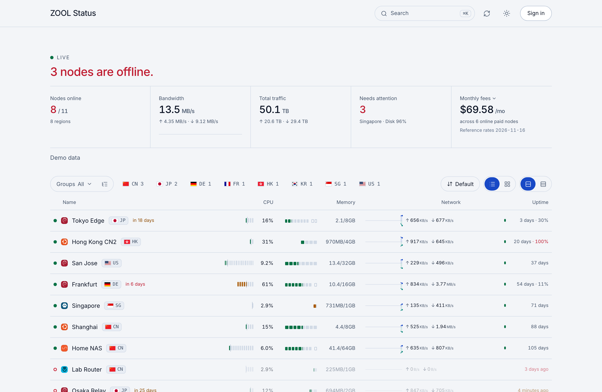
  </picture>
</p>

---

## Overview

`nezha-zool-theme` consolidates the formerly separate [zhdsmy/zool-theme](https://github.com/zhdsmy/zool-theme) and [zhdsmy/nezha-admin-frontend](https://github.com/zhdsmy/nezha-admin-frontend) repositories into a single `pnpm` workspace designed exclusively for **Nezha Dashboard v2.6+**:

| Package | Nezha Mount Target | Upstream Origin | Description |
| :--- | :--- | :--- | :--- |
| [`apps/frontend`](apps/frontend) | `user-dist` (`/`) | [foru17/zool-theme](https://github.com/foru17/zool-theme) | Public server status dashboard with ledger & card views, SVG gauges, TSDB history, multi-probe latency charts, and multi-currency billing summaries |
| [`apps/admin`](apps/admin) | `admin-dist` (`/dashboard`) | [nezhahq/admin-frontend](https://github.com/nezhahq/admin-frontend) | Full-featured Nezha management console restyled in the ZOOL palette with wide `96rem` tables, pinned columns, and mobile card ergonomics |

## Highlights

### Public Status Frontend (`apps/frontend`)
- **Dual Home Layouts & Grouping** — Switch seamlessly between a high-density **Ledger** view (`comfortable` or `compact` row density) and a visual **Cards** grid with live network sparklines, region filters, `⌘K` instant search, and optional grouping by Nezha server group.
- **SVG Instrument Telemetry** — Crisp circular utilization gauges, 7-day hourly reporting heatmaps, live WebSocket streaming buffers, and up to **30 days of TSDB load history** (`Live`, `1h`, `4h`, `1d`, `7d`, `30d`).
- **Multi-Probe Service Latency** — Dedicated latency chart per instance with range controls and one-click outlier filtering (**Hide spikes**) to keep transient jitter from flattening the scale.
- **Multi-Currency Fleet Billing** — Parses `billingDataMod` and `planDataMod` JSON from Nezha's `public_note` field to compute normalized monthly fleet spend across currencies, billing cycles (`Month`, `Quarter`, `Half`, `Year`), expiry countdowns, and traffic quotas.
- **Owner-Safe Upgrades** — Runtime settings live in a standalone `config.js` (`window.ZoolConfig`) excluded from release archives so updates never overwrite site customization.
- **4 Built-in Locales** — Complete translations for `en`, `zh-CN`, `zh-TW`, and `ja`, verified in CI/test scripts.

### Admin Panel (`apps/admin`)
- **Cohesive ZOOL Visual System** — Shares typography (`Inter` with `tabular-nums`), calm neutral surfaces, subtle borders, and light/dark tokens with the public status page.
- **Wide-Screen Server Operations** — Expanded `96rem` (`1536px`) container, sticky/pinned server name & action columns, stacked `IPv4` / `IPv6` addresses, inline filtering, batch update/delete/move actions, and browser WebSocket terminal & file manager.
- **Tablet & Phone Ergonomics** — Collapses horizontal navigation into a clean top-left page switcher on narrower viewports and transforms wide server tables into touch-friendly cards on mobile screens.
- **Full Nezha v2.6+ Parity** — Covers Servers, Service Monitors, Scheduled Tasks, Alert Rules, Notification Channels & Groups, Dynamic DNS, NAT Traversal, Server Groups, OAuth2 bindings, and MCP settings.

---

## Screenshots (Mock Fleet Data)

All screenshots below are rendered at `2×` Retina resolution using synthetic fleet & API mock data across **Desktop (`1440px`)**, **Tablet (`834px`)**, and **Mobile (`390px`)** viewports in both **Light** and **Dark** themes.

### 1. Public Status Frontend — Desktop (`1440px`)

#### Home Page: Ledger View (Light) vs. Cards View (Dark)
<table>
  <tr>
    <td width="50%" align="center">
      
      <br /><sub><strong>Light · Ledger View</strong> — Fleet overview, region pills, monthly cost converter & tabular node rows</sub>
    </td>
    <td width="50%" align="center">
      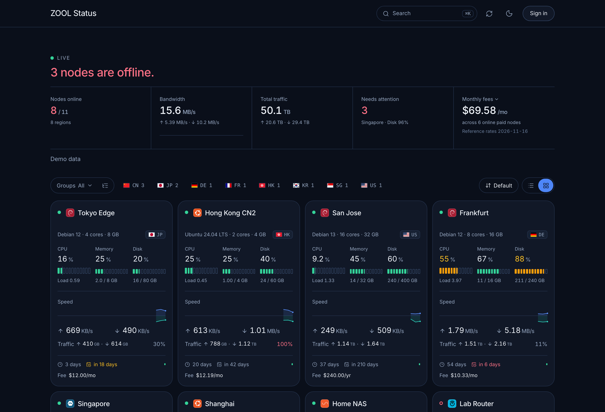
      <br /><sub><strong>Dark · Cards View</strong> — Live throughput sparklines, warning/critical badges & billing tags</sub>
    </td>
  </tr>
</table>

#### Instance Detail: Normal Node (Light) vs. Warning Node (Dark)
<table>
  <tr>
    <td width="50%" align="center">
      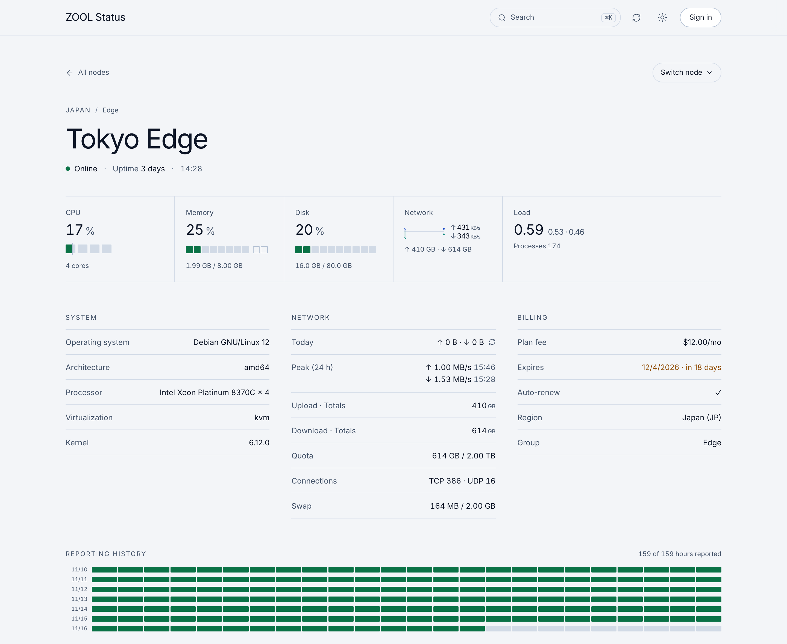
      <br /><sub><strong>Light · Instance Detail</strong> — Circular SVG gauges, hardware/network/billing ledger & 7-day reporting grid</sub>
    </td>
    <td width="50%" align="center">
      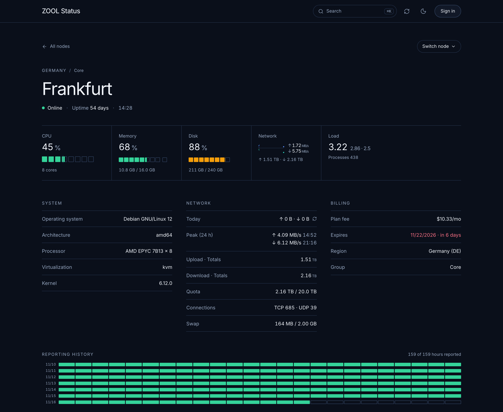
      <br /><sub><strong>Dark · Instance Detail</strong> — Elevated CPU & warning-band disk utilization state</sub>
    </td>
  </tr>
</table>

#### Historical Telemetry: 24h TSDB Load Bento (Dark) vs. Multi-Probe Latency (Light)
<table>
  <tr>
    <td width="50%" align="center">
      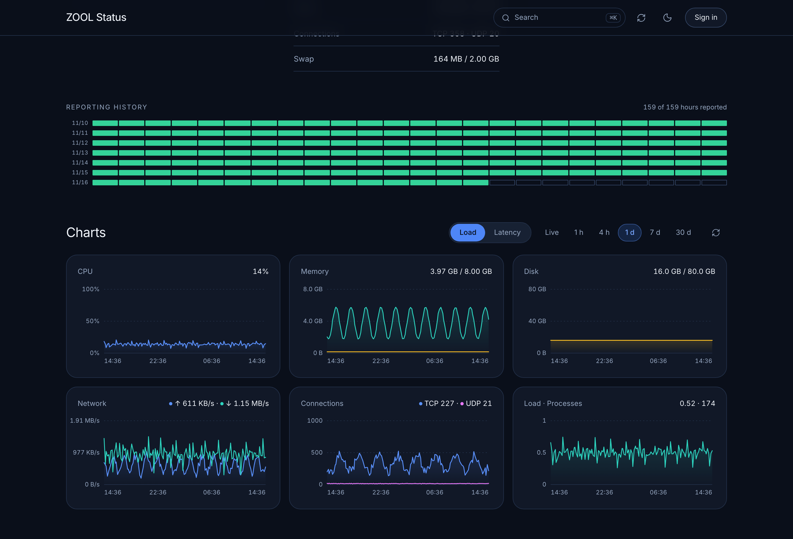
      <br /><sub><strong>Dark · 24h Load History</strong> — CPU, Memory, Disk, Network, Connections & Load/Processes SVG area charts</sub>
    </td>
    <td width="50%" align="center">
      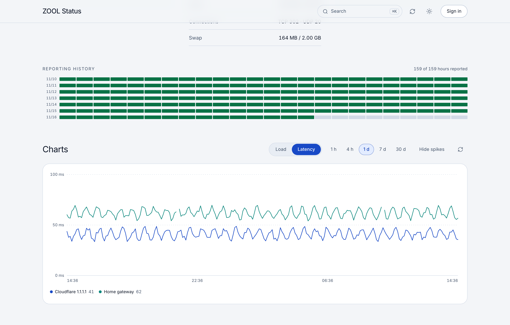
      <br /><sub><strong>Light · Service Latency</strong> — Multi-probe RTT series with range selector & <em>Hide spikes</em> filter</sub>
    </td>
  </tr>
</table>

---

### 2. Admin Panel — Desktop (`1440px`)

#### Server Management: Light vs. Dark Theme
<table>
  <tr>
    <td width="50%" align="center">
      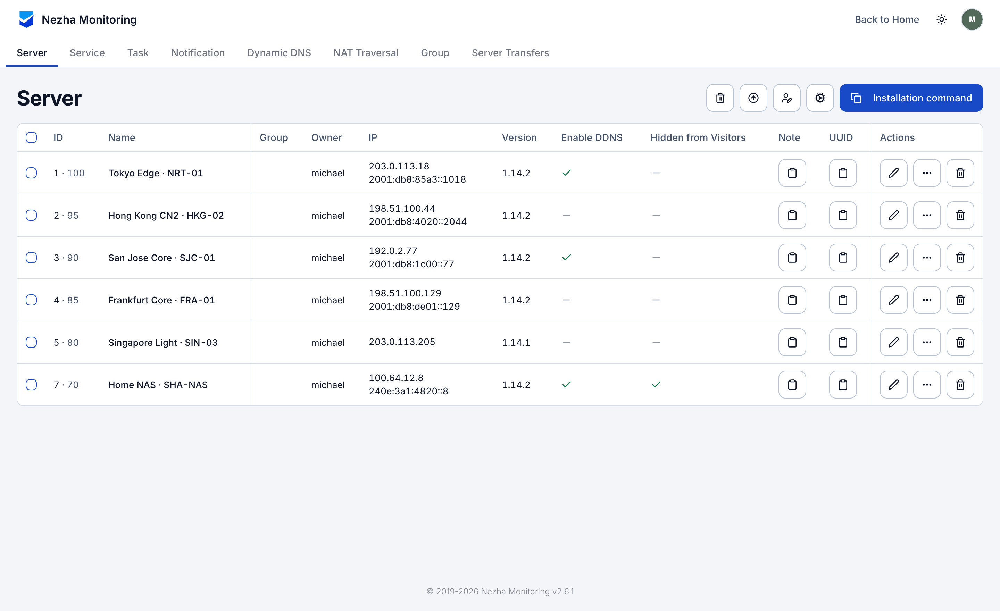
      <br /><sub><strong>Light · Server Fleet</strong> — Wide 96rem table, stacked IPv4/IPv6, batch toolbar & quick actions</sub>
    </td>
    <td width="50%" align="center">
      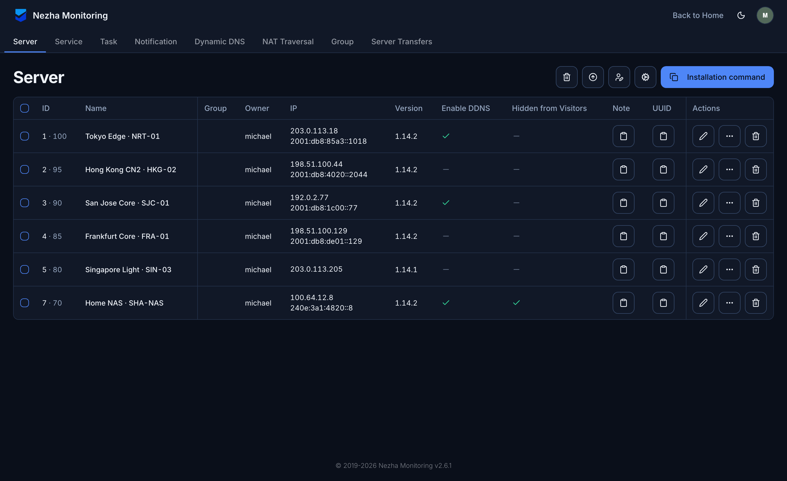
      <br /><sub><strong>Dark · Server Fleet</strong> — ZOOL dark surface hierarchy for low-glare operations</sub>
    </td>
  </tr>
</table>

#### Service Monitors (Light) & System Settings (Dark)
<table>
  <tr>
    <td width="50%" align="center">
      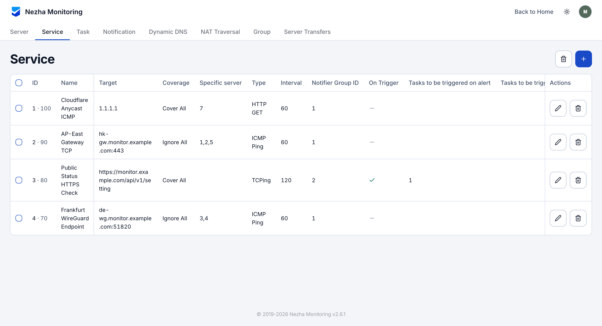
      <br /><sub><strong>Light · Service Monitors</strong> — ICMP / TCP / HTTPS probes, latency thresholds & coverage rules</sub>
    </td>
    <td width="50%" align="center">
      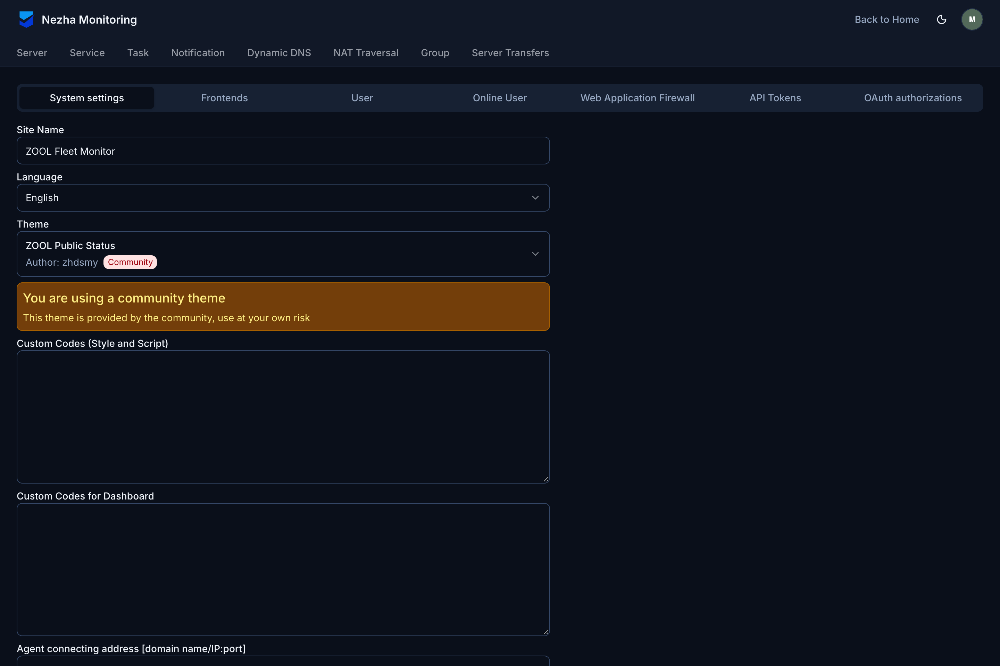
      <br /><sub><strong>Dark · System Settings</strong> — Site identity, custom theme selection, DNS & agent endpoints</sub>
    </td>
  </tr>
</table>

---

### 3. Tablet Viewport (`834px`) — Light & Dark

<table>
  <tr>
    <td width="50%" align="center">
      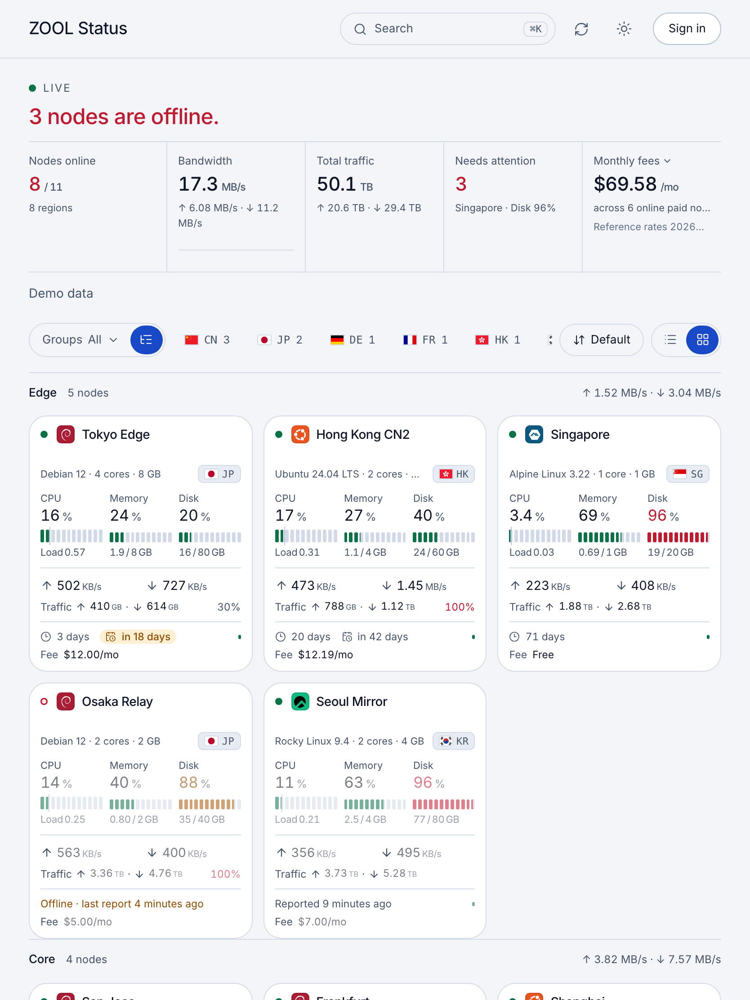
      <br /><sub><strong>Public Frontend · Light (834×1112)</strong> — 2-column Cards grouped by Nezha server group (<em>Edge</em> / <em>Core</em>)</sub>
    </td>
    <td width="50%" align="center">
      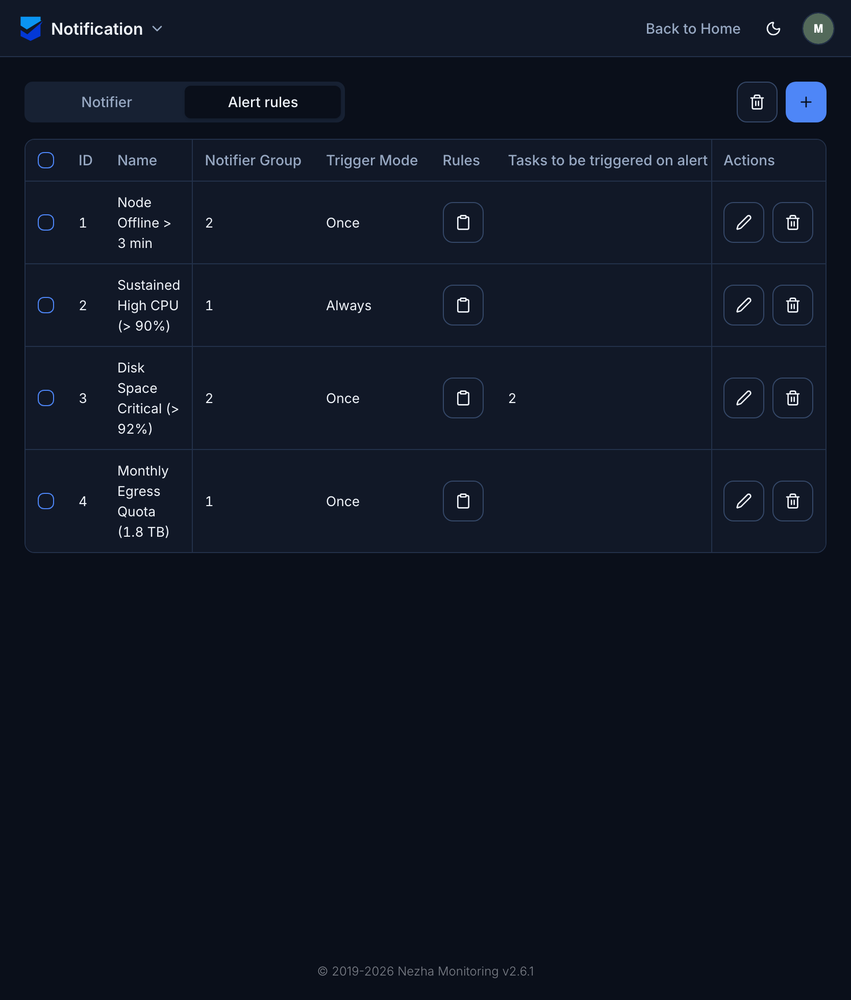
      <br /><sub><strong>Admin Panel · Dark (834×980)</strong> — Alert Rules table with compact top-left navigation dropdown</sub>
    </td>
  </tr>
</table>

---

### 4. Mobile Viewport (`390px`) — Light & Dark

<table>
  <tr>
    <td width="25%" align="center">
      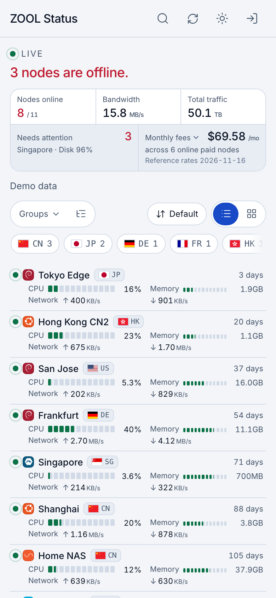
      <br /><sub><strong>Public Home · Light</strong><br />Compact overview bento & touch rows</sub>
    </td>
    <td width="25%" align="center">
      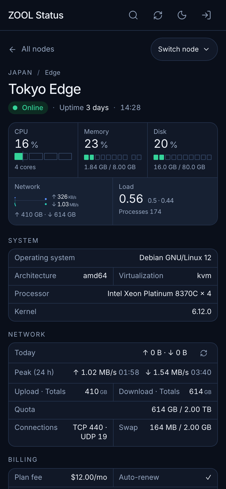
      <br /><sub><strong>Public Node · Dark</strong><br />Responsive 2×2 gauge grid</sub>
    </td>
    <td width="25%" align="center">
      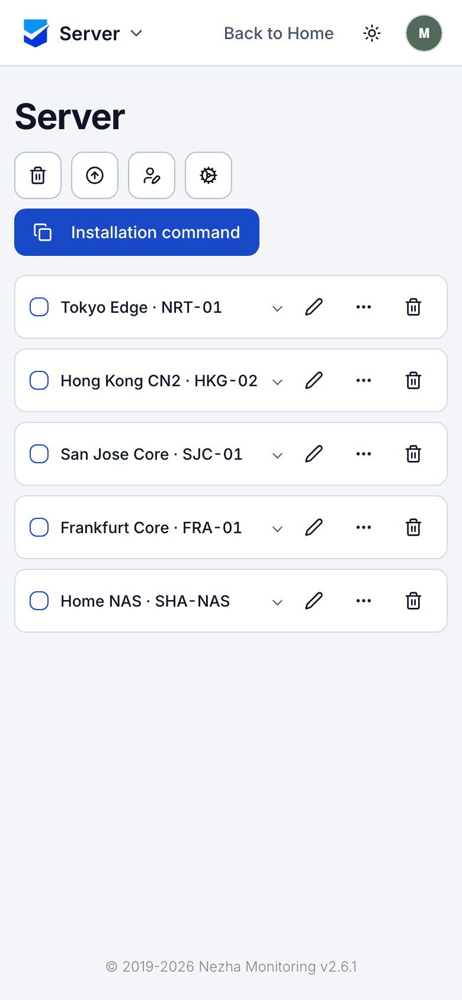
      <br /><sub><strong>Admin Servers · Light</strong><br />Collapsible mobile server cards</sub>
    </td>
    <td width="25%" align="center">
      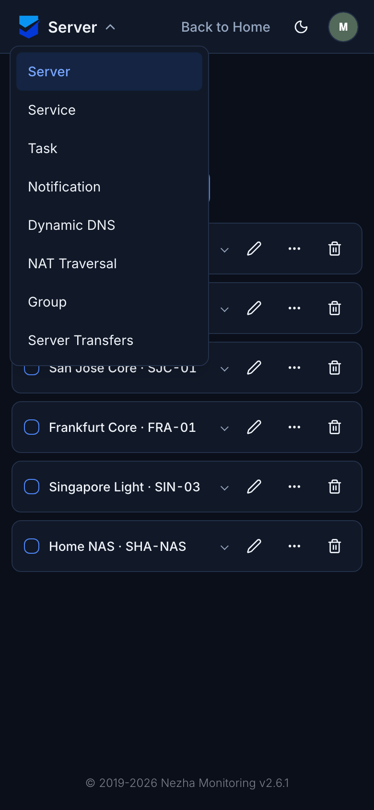
      <br /><sub><strong>Admin Nav · Dark</strong><br />Header page switcher menu</sub>
    </td>
  </tr>
</table>

---

## Deployment & Installation

### 1. Build Static Bundles

Requires **Node.js 22+** and **pnpm 10/12+**:

```bash
git clone https://github.com/zhdsmy/nezha-zool-theme.git
cd nezha-zool-theme
pnpm install

# Build both apps/frontend/dist and apps/admin/dist
pnpm build

# Optional: package frontend into release/nezha-zool-frontend-v0.1.0.zip (+ .sha256)
pnpm --filter frontend package
```

- `apps/frontend/dist` → mount to `/dashboard/user-dist` (or copy `apps/frontend/public/config.js` alongside `index.html` on first install).
- `apps/admin/dist` → mount to `/dashboard/admin-dist`.

### 2. Mount in Nezha Docker Compose

```yaml
services:
  dashboard:
    image: ghcr.io/nezhahq/nezha:latest
    restart: unless-stopped
    volumes:
      - ./data:/dashboard/data
      - ./nezha-zool-theme/user-dist:/dashboard/user-dist:ro
      - ./nezha-zool-theme/admin-dist:/dashboard/admin-dist:ro
    ports:
      - "8008:8008"
```

Ensure `data/config.yaml` points `user_template` and `admin_template` to `user-dist` and `admin-dist` (the Nezha defaults), or register them as custom template folders if you keep multiple themes installed.

> **Upgrade Tips**
> 1. **Preserve `config.js`**: `pnpm --filter frontend package` intentionally omits `config.js` from the release ZIP so upgrading never clobbers your live settings. Copy `apps/frontend/public/config.js` once on initial setup.
> 2. **Avoid cached-tab `404`s**: Copy new frontend builds *over* the existing `user-dist/` directory without immediately deleting older hashed files in `assets/` so visitors with an open tab can still lazy-load chunks cleanly.
> 3. **Keep `admin-dist` aligned with Nezha**: `apps/admin` calls Nezha's authenticated `/api/v1/*` management endpoints directly. When upgrading the Nezha backend across minor/major schema changes, rebuild `apps/admin` against the matching Swagger schema (`npx swagger-typescript-api -p http://localhost:8008/swagger/doc.json -o ./src/types -n api.ts --no-client --union-enums`).

---

## Frontend Runtime Configuration (`config.js`)

Edit `user-dist/config.js` on your server at any time—no rebuild required. Every field in `window.ZoolConfig` is optional:

| Key | Type & Values | Default | Description |
| :--- | :--- | :--- | :--- |
| `defaultAppearance` | `'system' \| 'light' \| 'dark'` | `'system'` | Initial theme before a visitor picks one |
| `defaultView` | `'ledger' \| 'cards'` | `'ledger'` | Initial home layout (visitors can switch anytime) |
| `defaultDensity` | `'comfortable' \| 'compact'` | `'comfortable'` | Row height in Ledger view |
| `defaultLanguage` | `'auto' \| 'en' \| 'zh-CN' \| 'zh-TW' \| 'ja'` | `'auto'` | UI locale (`'auto'` follows browser language) |
| `siteTitle` | `string` | `''` | Overrides `site_name` returned by Nezha settings |
| `showOverview` | `boolean` | `true` | Show the top fleet summary bar |
| `showCost` | `boolean` | `true` | Show total monthly fleet cost (requires billing JSON) |
| `showRegions` | `boolean` | `true` | Show country/region filter pills |
| `showGroups` | `boolean` | `true` | Allow filtering & grouping by Nezha server group |
| `defaultGrouped` | `boolean` | `false` | Group nodes by server group by default |
| `showBilling` | `boolean` | `true` | Display price/cycle & expiry badges on nodes |
| `showOffline` | `boolean` | `true` | Include offline servers in the public list |
| `hiddenNodes` | `string[]` | `[]` | Server IDs to hide on the frontend, e.g. `['12', '15']` |
| `hideAdminEntry` | `boolean` | `false` | Hide the top-right **Sign in** button |
| `footerNote` | `string` | `''` | Custom single-line note in the page footer |

### Billing & Plan Metadata (`public_note`)

In the Nezha Admin Panel, edit a server's **Public Note** with JSON to unlock automatic currency conversion, monthly spend rollups, expiry countdowns, and traffic quota bars:

```json
{
  "billingDataMod": {
    "startDate": "2026-01-15T00:00:00Z",
    "endDate": "2027-01-15T00:00:00Z",
    "autoRenewal": "1",
    "cycle": "Year",
    "amount": "$240"
  },
  "planDataMod": {
    "bandwidth": "1Gbps",
    "trafficVol": "2TB/Month",
    "trafficType": "2",
    "IPv4": "1",
    "IPv6": "1",
    "networkRoute": "CN2 GIA"
  }
}
```

---

## Local Development

```bash
# Run full workspace verification (typecheck + unit/i18n tests + production builds)
pnpm check

# Public Frontend: starts on http://127.0.0.1:5173 with built-in synthetic demo data
pnpm --filter frontend dev

# Or proxy Public Frontend against a live Nezha instance:
echo "ZOOL_UPSTREAM=https://monitor.example.com" > apps/frontend/.env.local
pnpm --filter frontend dev

# Admin Panel: starts on http://127.0.0.1:5173/dashboard (proxies /api & /mcp to 127.0.0.1:8008)
pnpm --filter admin-frontend dev
```

---

## License & Attribution

This repository is licensed under the **[MIT License](LICENSE)**.

- **Why MIT?** `apps/frontend` derives from [foru17/zool-theme](https://github.com/foru17/zool-theme) (**MIT License**, `Copyright (c) 2026 ZOOL LLC`), while `apps/admin` derives from [nezhahq/admin-frontend](https://github.com/nezhahq/admin-frontend) (**WTFPL v2**, `Copyright (C) 2024 nezhahq`). Licensing the combined workspace under **MIT** satisfies upstream MIT attribution requirements, is fully compatible with WTFPL's unrestricted relicensing terms, and keeps self-hosting and customization simple.
- Original upstream license texts are preserved verbatim in [`apps/frontend/LICENSE.upstream-MIT`](apps/frontend/LICENSE.upstream-MIT) and [`apps/admin/LICENSE.upstream-WTFPL`](apps/admin/LICENSE.upstream-WTFPL).
- **Trademark Disclaimer**: Not affiliated with or endorsed by ZOOL LLC or Nezha. The ZOOL name and logo are trademarks of ZOOL LLC and are not covered by the MIT License. See [`NOTICE.md`](NOTICE.md) for details.
