<h1 align="center">nezha-zool-theme</h1>

<p align="center">
  面向 <a href="https://github.com/nezhahq/nezha">哪吒监控 Nezha</a>（v2.6+）的一体化主题仓库：将冷静克制的仪表风 <strong>公开状态页前端（Frontend）</strong> 与同视觉语言的 <strong>管理后台（Admin）</strong> 整合于同一 Workspace。
</p>

<p align="center">
  <a href="LICENSE"></a>
  
  
  
  <a href="https://github.com/zhdsmy/nezha-zool-theme/commits/main"></a>
</p>

<p align="center">
  <a href="README.md">English</a> · <strong>简体中文</strong>
</p>

<p align="center">
  <picture>
    <source media="(prefers-color-scheme: dark)" srcset="docs/screenshots/zh-CN/frontend-cards-dark.png" />
    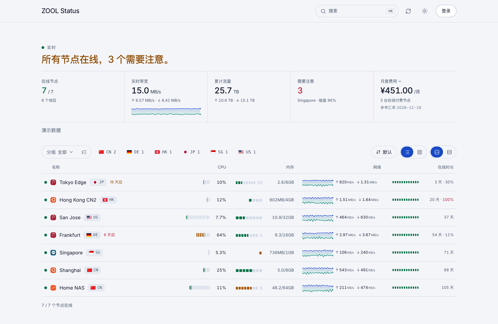
  </picture>
</p>

---

## 仓库概览

`nezha-zool-theme` 将原先独立维护的 [zhdsmy/zool-theme](https://github.com/zhdsmy/zool-theme) 与 [zhdsmy/nezha-admin-frontend](https://github.com/zhdsmy/nezha-admin-frontend) 整合为单一 `pnpm` Monorepo，仅专注于 **Nezha Dashboard v2.6+** 后端：

| 目录 | Nezha 挂载目录 | 上游来源 | 说明 |
| :--- | :--- | :--- | :--- |
| [`apps/frontend`](apps/frontend) | `user-dist` (`/`) | [foru17/zool-theme](https://github.com/foru17/zool-theme) | 公开探针状态页：支持台账列表（Ledger）与卡片（Cards）双视图、SVG 仪表盘、TSDB 历史曲线、多探针延迟图及多币种账单折算 |
| [`apps/admin`](apps/admin) | `admin-dist` (`/dashboard`) | [nezhahq/admin-frontend](https://github.com/nezhahq/admin-frontend) | ZOOL 视觉风格管理后台：`96rem` 宽屏表格、首尾固定列、双栈 IP 堆叠展示、移动端折叠卡片与顶部快捷切页菜单 |

## 核心特性

### 公开状态页（`apps/frontend`）
- **台账列表 & 卡片双视图** — 访客可在高密度 **Ledger 台账模式**（支持 `comfortable` / `compact` 行高）与带实时网速微图的 **Cards 卡片模式**间自由切换，支持地区筛选、`⌘K` 全局搜索以及按哪吒服务器分组聚合展示。
- **SVG 精密仪表与 30 天历史** — 节点详情页提供圆形资源仪表、7 天逐小时在线上报热力条、实时 WebSocket 缓冲曲线，以及最长 **30 天 TSDB 历史负载图**（`Live` / `1h` / `4h` / `1d` / `7d` / `30d`）。
- **多探针服务延迟与削峰过滤** — 支持多监控点 RTT 折线对比，并提供一键 **隐藏尖峰（Hide spikes）** 开关，避免偶发抖动压缩整张延迟图纵轴。
- **多币种月均费用折算** — 自动解析服务器公开备注（`public_note`）中的 `billingDataMod` 与 `planDataMod` JSON，支持多币种汇率换算、周期折算（月/季/半年/年）、到期倒计时与月度流量配额进度。
- **无损升级体验** — 站点配置独立存放于 `config.js`（`window.ZoolConfig`），打包产物默认不包含该文件，升级覆盖时不会冲掉站长自定义配置。
- **完整多语言与明暗主题** — 内置 `zh-CN`、`zh-TW`、`en`、`ja` 四种语言，支持跟随系统或手动切换浅色 / 深色模式。

### 管理后台（`apps/admin`）
- **统一 ZOOL 设计语言** — 与前台共享 `Inter` 等宽数字排版（`tabular-nums`）、柔和中性灰阶表面、低对比度分割线及一致的明暗色彩语义。
- **宽屏高密度运维表格** — 容器扩展至 `96rem`（`1536px`），服务器名称与操作列固定，`IPv4` / `IPv6` 上下堆叠展示，支持行内搜索、批量更新/删除/分组调整，以及浏览器端 WebSocket WebSSH 终端与文件管理。
- **平板与手机端自适应重构** — 窄屏下自动将顶部横向导航收纳为左上角页面切换菜单，手机端将宽表格转换为可勾选、可操作的高可读性卡片列表。
- **完整对齐 Nezha v2.6+ 功能** — 覆盖服务器管理、服务监控、计划任务、告警规则、通知方式与通知组、DDNS、内网穿透（NAT）、服务器分组、OAuth2 绑定与 MCP 设置。

---

## 界面截图展示（Mock 数据）

以下截图均通过内置演示数据与 Mock API 在 `2×` Retina 分辨率下实机渲染，涵盖 **桌面端（`1440px`）**、**平板端（`834px`）** 与 **手机端（`390px`）** 不同屏幕尺寸及 **浅色 / 深色** 主题。

安装 Playwright Chromium（`pnpm --dir apps/admin exec playwright install chromium`）后，运行 `NZT_DOCS_LANG=zh-CN pnpm screenshots` 生成简体中文截图，或运行 `pnpm screenshots` 生成英文截图。

### 1. 公开状态页 — 桌面端（`1440px`）

#### 首页：台账列表视图（浅色） vs. 卡片网格视图（深色）
<table>
  <tr>
    <td width="50%" align="center">
      
      <br /><sub><strong>浅色 · Ledger 台账视图</strong> — 集群总览、地区筛选、多币种月费汇总与高密度指标行</sub>
    </td>
    <td width="50%" align="center">
      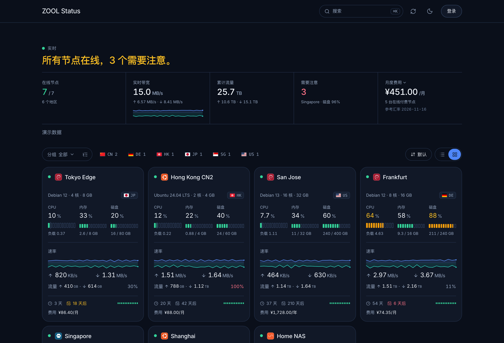
      <br /><sub><strong>深色 · Cards 卡片视图</strong> — 实时吞吐微图、告警/到期角标与账单标签</sub>
    </td>
  </tr>
</table>

#### 节点详情页：常规节点（浅色） vs. 高负载告警节点（深色）
<table>
  <tr>
    <td width="50%" align="center">
      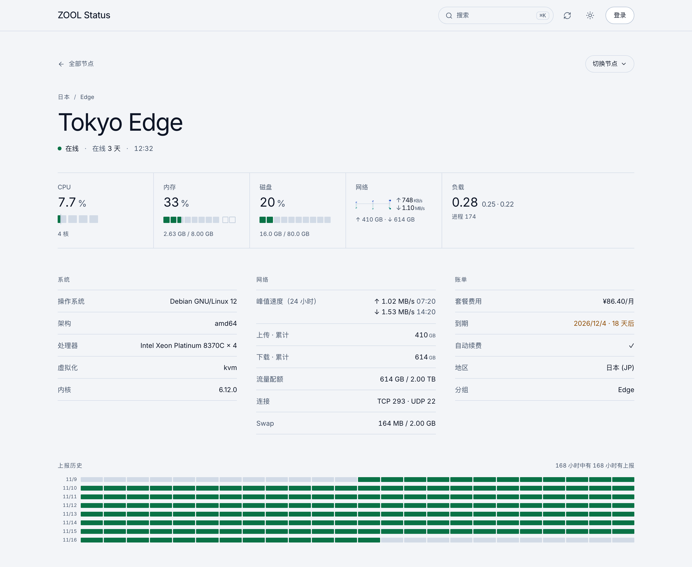
      <br /><sub><strong>浅色 · 节点详情</strong> — SVG 环形仪表、硬件/网络/账单信息台账与 7 天上报热力条</sub>
    </td>
    <td width="50%" align="center">
      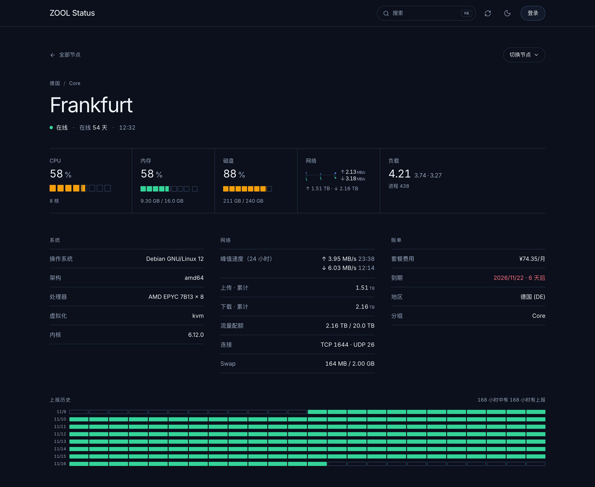
      <br /><sub><strong>深色 · 节点详情</strong> — 磁盘预警阈值着色与高负载状态展示</sub>
    </td>
  </tr>
</table>

#### 历史监控图表：24 小时 TSDB 负载（深色） vs. 多探针网络延迟（浅色）
<table>
  <tr>
    <td width="50%" align="center">
      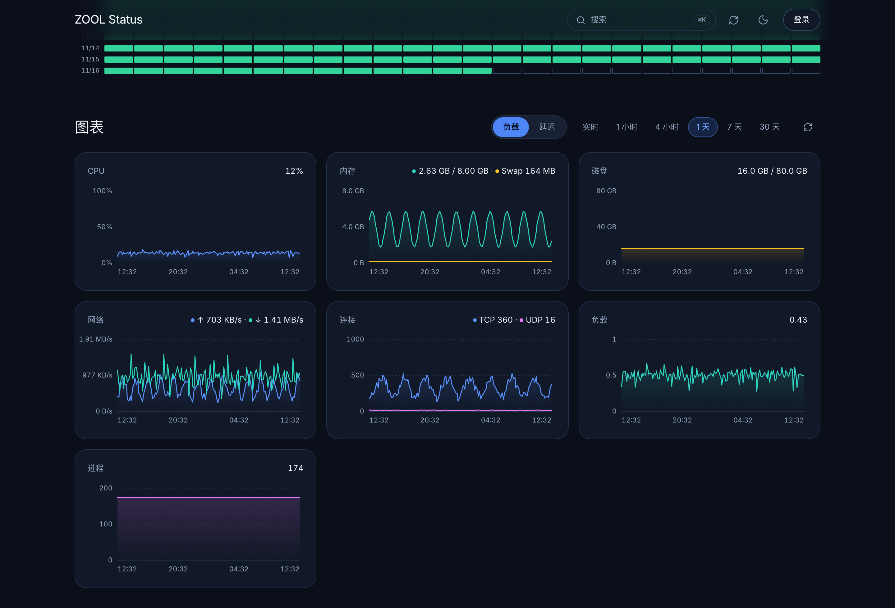
      <br /><sub><strong>深色 · 24h 历史负载</strong> — CPU、内存、磁盘、网络、连接数与负载/进程六宫格面积图</sub>
    </td>
    <td width="50%" align="center">
      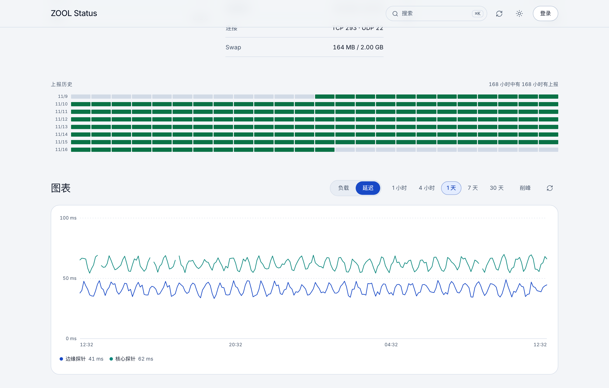
      <br /><sub><strong>浅色 · 服务监控延迟</strong> — 多探针 RTT 历史曲线、时间跨度切换与 <em>Hide spikes</em> 削峰过滤</sub>
    </td>
  </tr>
</table>

---

### 2. 管理后台 — 桌面端（`1440px`）

#### 服务器管理：浅色模式 vs. 深色模式
<table>
  <tr>
    <td width="50%" align="center">
      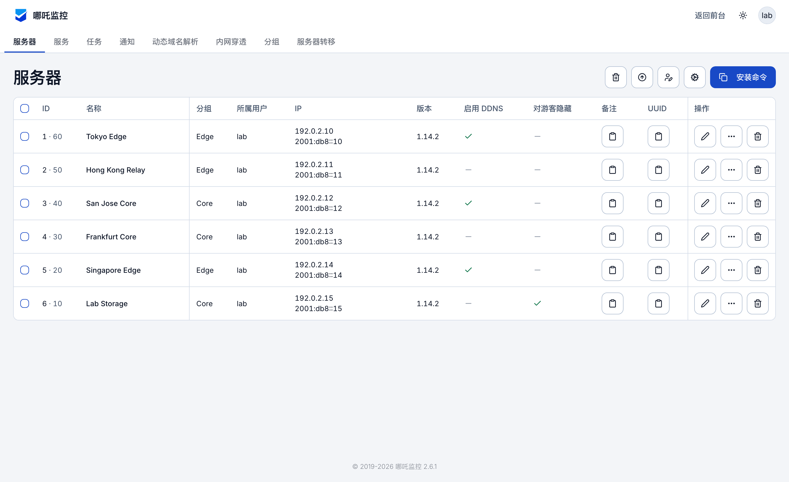
      <br /><sub><strong>浅色 · 服务器列表</strong> — 96rem 宽屏表格、双栈 IP 堆叠、批量操作栏与一键安装命令</sub>
    </td>
    <td width="50%" align="center">
      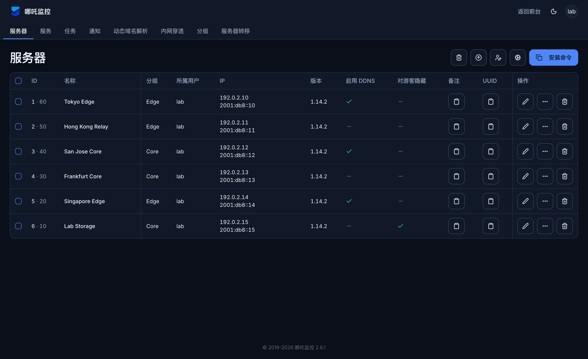
      <br /><sub><strong>深色 · 服务器列表</strong> — 低眩光深色层级，适合夜间运维</sub>
    </td>
  </tr>
</table>

#### 服务监控（浅色） & 系统设置（深色）
<table>
  <tr>
    <td width="50%" align="center">
      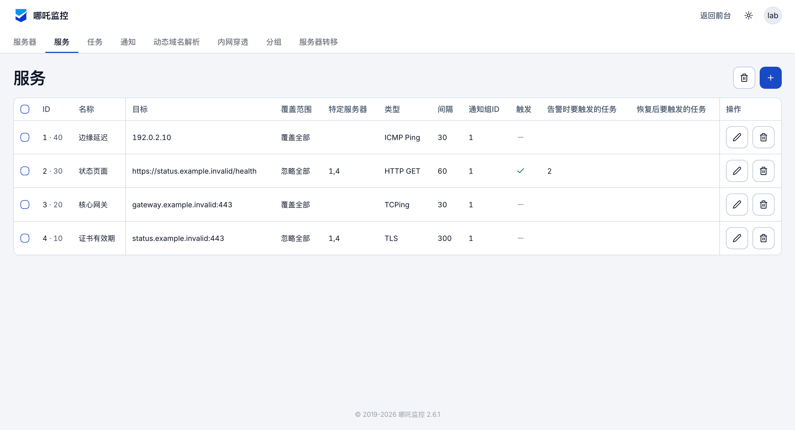
      <br /><sub><strong>浅色 · 服务监控</strong> — ICMP / TCP / HTTPS 拨测规则、延迟阈值与排除节点配置</sub>
    </td>
    <td width="50%" align="center">
      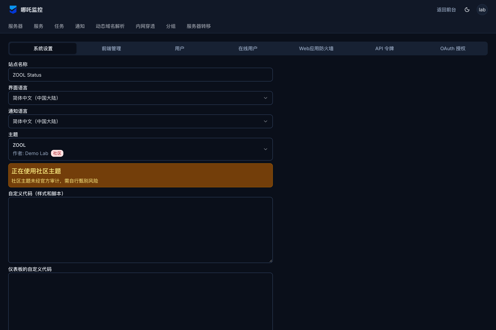
      <br /><sub><strong>深色 · 系统设置</strong> — 站点名称、自定义前后台模板选择、DNS 与 Agent 接入配置</sub>
    </td>
  </tr>
</table>

---

### 3. 平板端视口（`834px`）— 浅色 & 深色

<table>
  <tr>
    <td width="50%" align="center">
      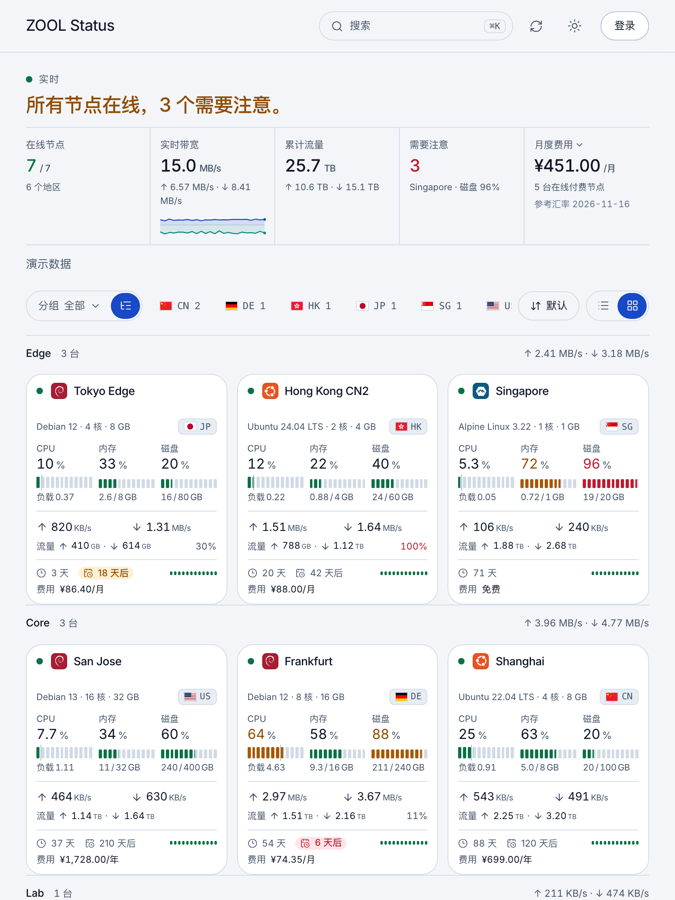
      <br /><sub><strong>公开状态页 · 浅色（834×1112）</strong> — 双列卡片视图按服务器分组（<em>Edge</em> / <em>Core</em>）聚合</sub>
    </td>
    <td width="50%" align="center">
      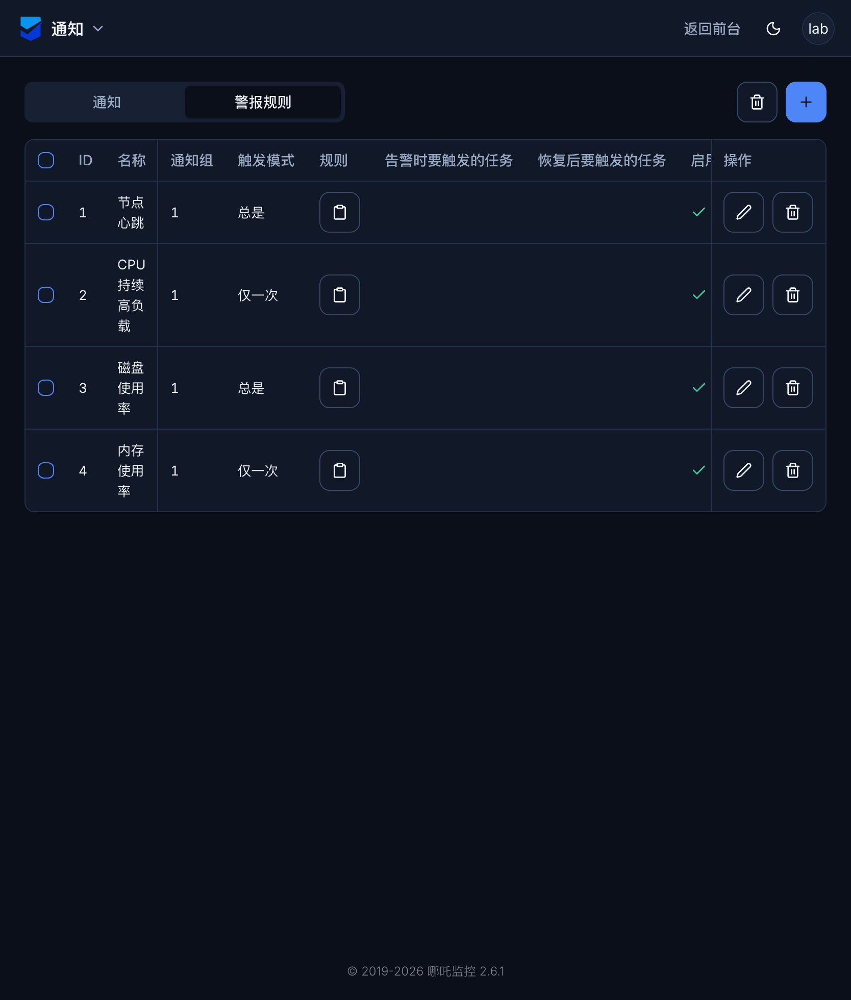
      <br /><sub><strong>管理后台 · 深色（834×980）</strong> — 告警规则管理与左上角响应式下拉导航</sub>
    </td>
  </tr>
</table>

---

### 4. 手机端视口（`390px`）— 浅色 & 深色

<table>
  <tr>
    <td width="25%" align="center">
      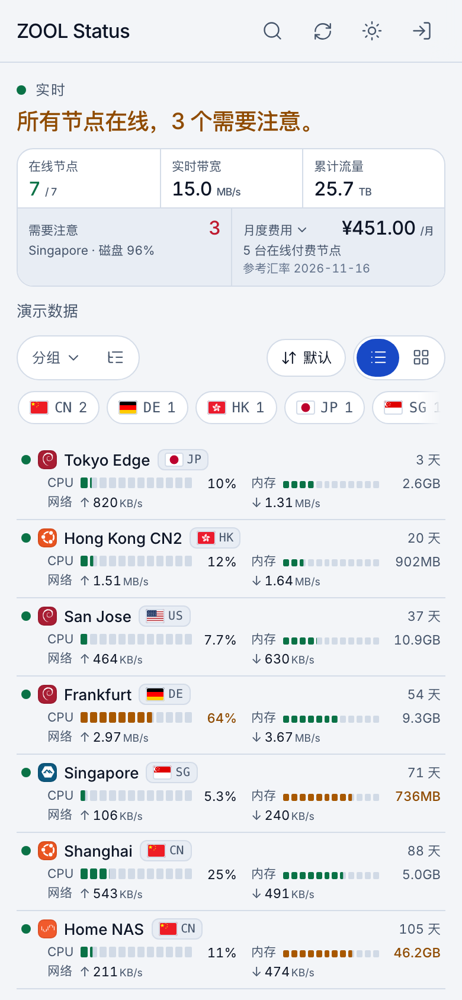
      <br /><sub><strong>公开首页 · 浅色</strong><br />移动端总览卡片与紧凑列表</sub>
    </td>
    <td width="25%" align="center">
      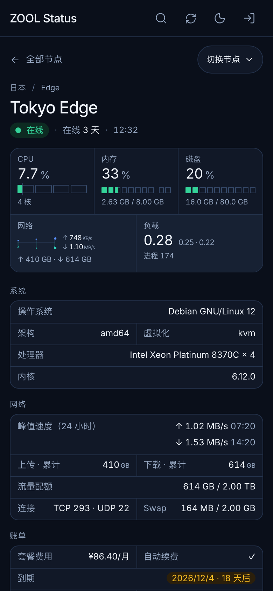
      <br /><sub><strong>节点详情 · 深色</strong><br />自适应 2×2 环形仪表</sub>
    </td>
    <td width="25%" align="center">
      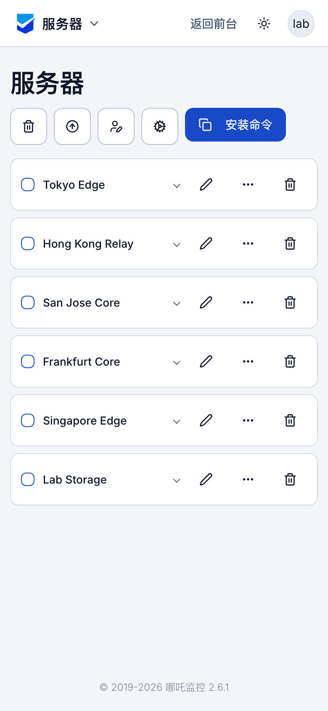
      <br /><sub><strong>后台服务器 · 浅色</strong><br />窄屏触控友好的卡片行</sub>
    </td>
    <td width="25%" align="center">
      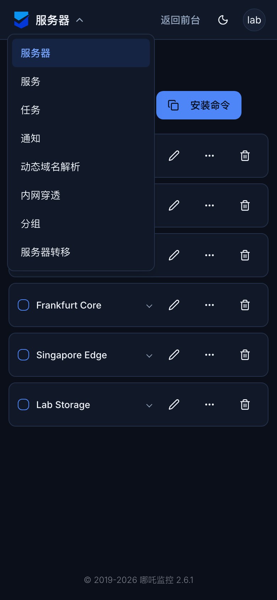
      <br /><sub><strong>后台导航 · 深色</strong><br />顶部下拉快速切换页面</sub>
    </td>
  </tr>
</table>

---

## 部署与安装指南

### 用 Nezha v2.6+ 前端管理器安装

1. 打开「设置 → 前端管理」，选择「用户前端」。填写 `https://github.com/zhdsmy/nezha-zool-theme`，点击「读取发布版本」。
2. 安装所需版本，点击「启用」。打开 `/` 检查公开状态页。
3. 选择「管理后台前端」，填写 `https://github.com/zhdsmy/nezha-zool-admin`。安装并启用同名版本，打开 `/dashboard/` 检查后台。

两个仓库分别提供安装器识别的 `dist.zip`，包内入口均为 `dist/index.html`。需要回滚时，在对应的前端类型下启用旧版本或内置前端。

### 本地构建与发布

发布工作流使用 Node.js 26.13.1、pnpm 12.21.0 和 Python 3。

```bash
git clone https://github.com/zhdsmy/nezha-zool-theme.git
cd nezha-zool-theme
pnpm install --frozen-lockfile
pnpm test:release
pnpm package
```

主题仓库收到版本标签（如 `v0.1.0`）后，工作流先运行检查，再发布前台包 `release/dist.zip`、后台包 `release/nezha-zool-admin-dist.zip` 和各自的 `.sha256`。发布说明取自 `CHANGELOG.md` 的对应版本。主题版本公开后，在后台仓库推送同名标签。后台工作流校验后台包，以 `dist.zip` 的名称发布。完整步骤见[维护指南](deploy/admin-repo/MAINTAINERS.md)。

### 手工安装与 Docker Compose 挂载

用对应的校验文件验证每个 ZIP，例如 `sha256sum -c dist.zip.sha256`。将解压后 `dist/` **里面的文件**复制到下方宿主机的 `user-dist/` 或 `admin-dist/` 目录。两个 ZIP 均排除 `config.js`。首次手工安装需要自定义前台时，将 `apps/frontend/public/config.js` 复制到前台 `index.html` 旁。

```yaml
services:
  dashboard:
    image: ghcr.io/nezhahq/nezha:latest
    restart: unless-stopped
    volumes:
      - ./data:/dashboard/data
      - ./nezha-zool-theme/user-dist:/dashboard/user-dist:ro
      - ./nezha-zool-theme/admin-dist:/dashboard/admin-dist:ro
    ports:
      - "8008:8008"
```

请确保 `data/config.yaml` 中的 `user_template` 与 `admin_template` 指向 `user-dist` 与 `admin-dist`（哪吒默认值），或者挂载为独立主题目录后在后台「系统设置」中切换启用。

> **平滑升级建议**
> 1. **保留 `config.js`**：手工升级时保留站点现有的配置文件。
> 2. **避免旧标签页 `404`**：更新前台静态文件时建议直接增量覆盖 `user-dist/`，暂缓清理旧的哈希静态资源 `assets/`，以免仍停留在旧页面的访客懒加载分包时遇到 `404`。
> 3. **后台版本同步**：`apps/admin` 直接对接哪吒 `/api/v1/*` 管理接口。升级哪吒后端大/小版本时，若接口字段变动，请同步更新类型定义并重新构建 `apps/admin`。

---

## 前台运行时配置（`config.js`）

直接修改服务器 `user-dist/config.js` 即可实时生效，无需重新编译。`window.ZoolConfig` 所有字段均为可选项：

| 配置项 | 类型与可选值 | 默认值 | 说明 |
| :--- | :--- | :--- | :--- |
| `defaultAppearance` | `'system' \| 'light' \| 'dark'` | `'system'` | 访客首次打开时的默认明暗外观 |
| `defaultView` | `'ledger' \| 'cards'` | `'ledger'` | 首页默认布局（台账列表 / 卡片网格） |
| `defaultDensity` | `'comfortable' \| 'compact'` | `'comfortable'` | Ledger 台账模式下的默认行高密度 |
| `defaultLanguage` | `'auto' \| 'en' \| 'zh-CN' \| 'zh-TW' \| 'ja'` | `'auto'` | 默认界面语言（`'auto'` 自动跟随浏览器） |
| `siteTitle` | `string` | `''` | 覆盖哪吒后台设置的站点标题 |
| `showOverview` | `boolean` | `true` | 是否展示顶部集群汇总指标栏 |
| `showCost` | `boolean` | `true` | 是否展示月均总费用（需配置账单 JSON） |
| `showRegions` | `boolean` | `true` | 是否展示国家/地区快速筛选栏 |
| `showGroups` | `boolean` | `true` | 是否允许按哪吒服务器分组筛选与聚合 |
| `defaultGrouped` | `boolean` | `false` | 是否默认开启「按分组展示」 |
| `showBilling` | `boolean` | `true` | 是否在节点上显示价格周期与到期时间 |
| `showOffline` | `boolean` | `true` | 是否在公开列表中显示离线服务器 |
| `hiddenNodes` | `string[]` | `[]` | 在公开页隐藏指定服务器 ID，如 `['12', '15']` |
| `hideAdminEntry` | `boolean` | `false` | 隐藏右上角后台登录（Sign in）入口 |
| `footerNote` | `string` | `''` | 页脚自定义单行备注文本 |

### 公开备注账单配置（`public_note`）

在哪吒管理后台编辑服务器的 **公开备注（Public Note）** 填入如下 JSON，即可启用自动多币种换算、月度支出汇总、到期提醒及流量配额条：

```json
{
  "billingDataMod": {
    "startDate": "2026-01-15T00:00:00Z",
    "endDate": "2027-01-15T00:00:00Z",
    "autoRenewal": "1",
    "cycle": "Year",
    "amount": "$240"
  },
  "planDataMod": {
    "bandwidth": "1Gbps",
    "trafficVol": "2TB/Month",
    "trafficType": "2",
    "IPv4": "1",
    "IPv6": "1",
    "networkRoute": "CN2 GIA"
  }
}
```

---

## 本地开发与校验

```bash
# 一键运行全仓类型检查 + 单元/多语言完整性测试 + 生产构建
pnpm check

# 启动公开状态页（默认使用内置合成演示数据，监听 http://127.0.0.1:5173）
pnpm --filter frontend dev

# 若需连接真实哪吒面板调试公开状态页：
echo "ZOOL_UPSTREAM=https://monitor.example.com" > apps/frontend/.env.local
pnpm --filter frontend dev

# 启动管理后台（监听 http://127.0.0.1:5173/dashboard，自动代理 /api 与 /mcp 至 127.0.0.1:8008）
pnpm --filter admin-frontend dev
```

---

## 开源协议与致谢（License）

本仓库整体采用 **[MIT License](LICENSE)** 开源发布。

- **为什么推荐并采用 MIT 协议？**
  - `apps/frontend` 衍生自 [foru17/zool-theme](https://github.com/foru17/zool-theme)（采用 **MIT License**，`Copyright (c) 2026 ZOOL LLC`），要求衍生作品保留其版权声明与许可文本；
  - `apps/admin` 衍生自 [nezhahq/admin-frontend](https://github.com/nezhahq/admin-frontend)（采用 **WTFPL v2**，`Copyright (C) 2024 nezhahq`），允许无限制地修改、合并及以任何协议再发布；
  - 因此以 **MIT License** 作为合并仓库的主协议，既严格满足 `foru17/zool-theme` 的 MIT 合规要求，又完全兼容 `nezhahq/admin-frontend` 的 WTFPL 授权，同时能被 GitHub 原生识别，对自建用户与二次开发者最为友好。
- 上游原始许可证全文完整保留于 [`apps/frontend/LICENSE.upstream-MIT`](apps/frontend/LICENSE.upstream-MIT) 与 [`apps/admin/LICENSE.upstream-WTFPL`](apps/admin/LICENSE.upstream-WTFPL)。
- **商标说明**：本项目为独立社区维护主题，与 ZOOL LLC 及 Nezha 官方无隶属或背书关系。**ZOOL** 名称与标志系 ZOOL LLC 的商标，不在 MIT 许可证授权范围内，详见 [`NOTICE.md`](NOTICE.md)。
